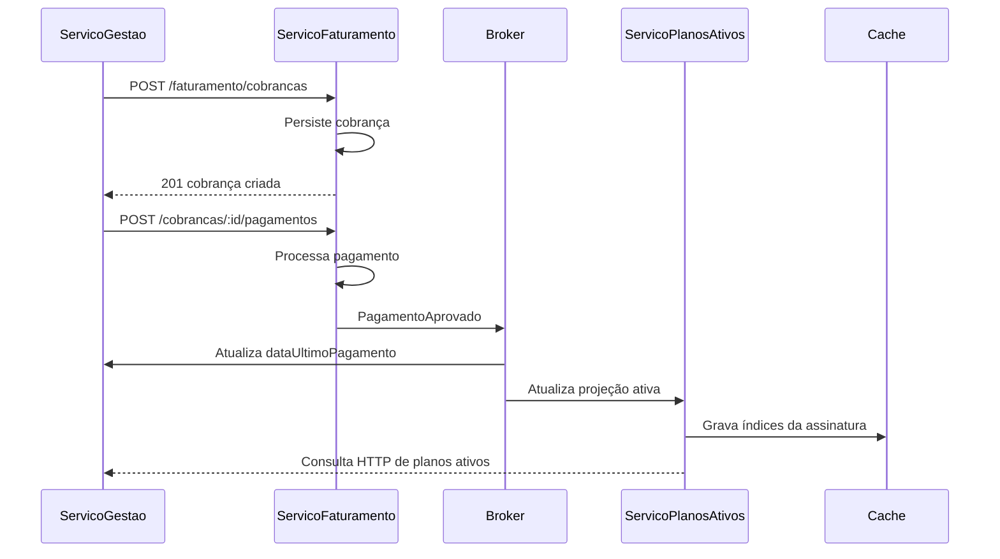

# Mapeamento detalhado dos serviços — Fase 2

## 1. Objetivo

A Fase 2 complementará o `ServicoGestao` com o processamento de pagamentos e a consulta de planos ativos. O desenho abaixo detalha as responsabilidades que estavam apenas indicadas no diagrama geral da Fase 1. Os serviços serão implementados separadamente, mantendo baixo acoplamento por meio de eventos publicados em um broker.

> **Escopo:** este documento descreve o contrato e o fluxo previstos para a Fase 2. Os serviços, endpoints e eventos abaixo não fazem parte da execução atual do `ServicoGestao` da Fase 1.

## 2. Componentes e responsabilidades

| Componente | Responsabilidade | Dados principais | Comunicação |
|---|---|---|---|
| `ServicoGestao` | Mantém clientes, planos e assinaturas; inicia o fluxo de pagamento quando necessário. | Cliente, plano, assinatura, `dataUltimoPagamento`, custo final e fidelidade. | HTTP síncrono com consumidores; publica/consome eventos pelo broker. |
| `ServicoFaturamento` | Registra cobranças, processa pagamentos e mantém o histórico financeiro. | Cobrança, pagamento, valor, vencimento, situação e data de processamento. | Recebe comandos/eventos e publica resultado do pagamento. |
| `ServicoPlanosAtivos` | Mantém a visão persistida de assinaturas com pagamento vigente e disponibiliza consultas rápidas. | Assinatura ativa, cliente, plano, vigência e último pagamento. | Consome eventos de pagamento, atualiza seu banco próprio e o cache. |
| Broker | Transporta mensagens assíncronas entre faturamento, gestão e planos ativos. | Mensagens versionadas, com identificador, data e origem. | Publicação e consumo em tópicos/filas. |
| Banco de Dados do Faturamento | Persiste cobranças e pagamentos do `ServicoFaturamento`. | Tabelas de cobrança e pagamento. | Acesso exclusivo pelo serviço de faturamento. |
| Banco de Dados dos Planos Ativos | Persiste a projeção das assinaturas ativas do `ServicoPlanosAtivos`. | Assinatura ativa, cliente, plano, valor e último pagamento. | Acesso exclusivo pelo serviço de planos ativos. |

## 3. Endpoints previstos

### 3.1 `ServicoFaturamento`

| Método | Endpoint | Finalidade | Resposta esperada |
|---|---|---|---|
| `POST` | `/faturamento/cobrancas` | Criar uma cobrança para uma assinatura válida. | Identificador da cobrança, assinatura, valor, vencimento e situação inicial. |
| `GET` | `/faturamento/cobrancas/:codigoCobranca` | Consultar uma cobrança individual. | Dados da cobrança e do pagamento associado, quando existir. |
| `POST` | `/faturamento/cobrancas/:codigoCobranca/pagamentos` | Registrar/processar o pagamento de uma cobrança. | Resultado do processamento e situação do pagamento. |
| `GET` | `/faturamento/pagamentos/:codigoPagamento` | Consultar o resultado de um pagamento. | Identificador, cobrança, valor, data e situação. |
| `GET` | `/faturamento/assinaturas/:codigoAssinatura/pagamentos` | Listar o histórico de pagamentos de uma assinatura. | Lista ordenada por data de processamento. |

O serviço deve validar a existência da cobrança, impedir o processamento duplicado do mesmo pagamento e manter a operação idempotente por meio de uma chave de requisição ou identificador externo. Em caso de aprovação, deverá publicar o evento `PagamentoAprovado`; em caso de recusa, deverá publicar `PagamentoRecusado`.

### 3.2 `ServicoPlanosAtivos`

| Método | Endpoint | Finalidade | Fonte prioritária |
|---|---|---|---|
| `GET` | `/planos-ativos` | Listar todas as assinaturas com pagamento vigente. | Banco próprio, com cache como otimização. |
| `GET` | `/planos-ativos/clientes/:codigoCliente` | Listar os planos ativos de um cliente. | Banco próprio indexado por cliente. |
| `GET` | `/planos-ativos/planos/:codigoPlano` | Listar clientes que possuem determinado plano ativo. | Banco próprio indexado por plano. |
| `GET` | `/planos-ativos/assinaturas/:codigoAssinatura` | Consultar a visão ativa de uma assinatura. | Banco próprio, com cache por assinatura como otimização. |

O `ServicoPlanosAtivos` não deve recalcular o histórico financeiro. Ele deve reagir aos eventos do broker, atualizar sua projeção e retirar ou marcar como inativa uma assinatura quando receber um pagamento recusado, estornado ou vencido, conforme a regra de negócio definida para a Fase 2.

## 4. Eventos assíncronos

| Evento | Publicador | Consumidores | Momento de publicação |
|---|---|---|---|
| `CobrancaCriada` | `ServicoFaturamento` | `ServicoGestao`, auditoria ou monitoramento. | Após persistir uma nova cobrança. |
| `PagamentoAprovado` | `ServicoFaturamento` | `ServicoGestao` e `ServicoPlanosAtivos`. | Depois da confirmação da aprovação. |
| `PagamentoRecusado` | `ServicoFaturamento` | `ServicoGestao` e `ServicoPlanosAtivos`. | Depois da confirmação da recusa. |
| `PagamentoEstornado` | `ServicoFaturamento` | `ServicoGestao` e `ServicoPlanosAtivos`. | Quando um pagamento aprovado for revertido. |
| `AssinaturaAtivada` | `ServicoGestao` ou `ServicoPlanosAtivos` | `ServicoPlanosAtivos` e consumidores de negócio. | Quando o pagamento vigente tornar a assinatura ativa. |
| `AssinaturaCancelada` | `ServicoGestao` ou `ServicoPlanosAtivos` | Cache e consumidores de negócio. | Quando o pagamento deixar de ser vigente. |

Cada mensagem deverá carregar, no mínimo, `eventId`, `eventType`, `occurredAt`, `aggregateId`, `correlationId`, `version` e `payload`. O consumidor deverá aceitar reentrega sem duplicar efeitos, registrando o `eventId` processado ou aplicando uma operação naturalmente idempotente.

## 5. Fluxo principal

Em uma recusa ou estorno, o fluxo é equivalente, mas o evento publicado é `PagamentoRecusado` ou `PagamentoEstornado`. Nesses casos, a projeção do `ServicoPlanosAtivos` deve ser removida ou marcada como inativa, e o `ServicoGestao` deve atualizar a situação da assinatura conforme a regra oficial da fase.

## 6. Persistência e cache

O banco do `ServicoFaturamento` é separado do banco do `ServicoGestao` e persiste as tabelas `cobrancas` e `pagamentos`. O `ServicoPlanosAtivos` mantém o banco `planos_ativos`, com sua própria projeção persistida e índices por cliente e plano. O cache em memória é apenas uma otimização de leitura e pode ser reconstruído a partir do banco e dos eventos.

| Chave de cache | Conteúdo | Invalidação/atualização |
|---|---|---|
| `plano-ativo:assinatura:{id}` | Visão ativa de uma assinatura. | Atualiza em `PagamentoAprovado`; remove em recusa, estorno ou cancelamento. |
| `plano-ativo:cliente:{id}` | Lista de assinaturas ativas do cliente. | Reindexa após qualquer alteração da assinatura. |
| `plano-ativo:plano:{id}` | Lista de assinaturas ativas do plano. | Reindexa após ativação ou desativação. |
| `planos-ativos:todos` | Lista geral de planos ativos. | Invalida ou atualiza após eventos de domínio. |

## 7. Requisitos não funcionais da implementação

A implementação mantém separação entre controllers, casos de uso, entidades, contratos de repositório e adaptadores de infraestrutura. Cada microsserviço possui seu próprio banco de dados. O broker e o cache devem ser acessados por interfaces, permitindo testes unitários sem dependência de serviços externos. Também deverão ser previstos rastreamento por `correlationId`, logs estruturados, tratamento de falhas de consumo e estratégia de retry com fila de mensagens não processadas.

## 8. Relação com a Fase 1

A Fase 1 continua responsável pelo `ServicoGestao` e pelos endpoints já documentados na coleção Postman. A regra de classificação de `ATIVO` e `CANCELADO` utiliza `dataUltimoPagamento` vigente; `fimFidelidade` permanece como informação do período de fidelidade da assinatura, mas não determina o status. A coleção do Postman foi preservada e continua apontando para `http://localhost:3000`.

## 9. Critérios de aceite da Fase 2

| Critério | Verificação |
|---|---|
| Cobrança criada uma única vez | Repetição da mesma requisição não gera duplicidade. |
| Pagamento aprovado publicado | O evento chega aos consumidores com contrato versionado. |
| Projeção ativa atualizada | A assinatura aparece nas consultas do `ServicoPlanosAtivos`. |
| Pagamento recusado/estornado tratado | A assinatura deixa de aparecer como ativa quando aplicável. |
| Recuperação após falha | Mensagens podem ser reprocessadas sem efeitos duplicados. |
| Cache consistente | Atualizações e invalidações ocorrem após cada evento relevante. |
